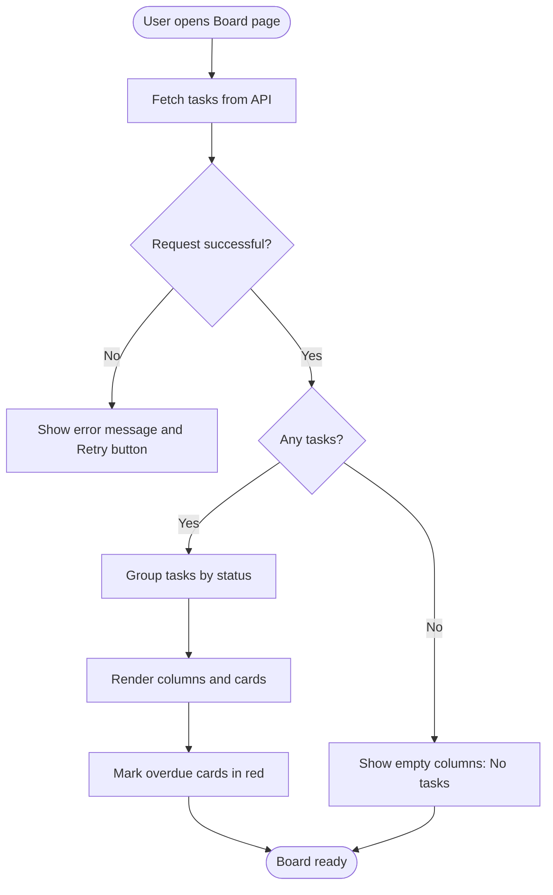
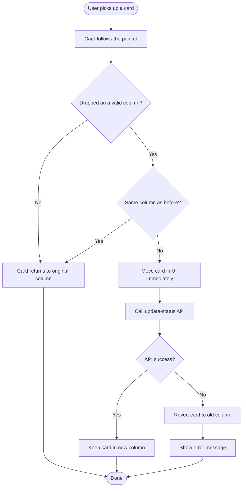
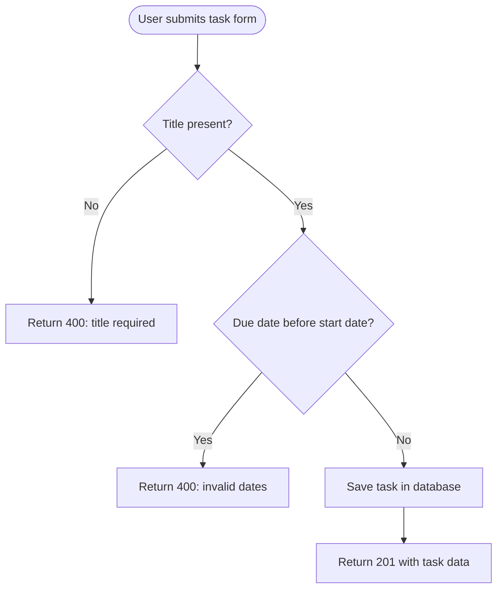
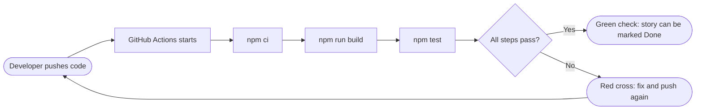

# Initiative 1: Kanban (Board View)

**Goal:** Show tasks as cards in status columns (To Do, In Progress, Review, Done). Users move cards by drag and drop to track daily work.

**Build order:** First. This initiative includes **Epic 1.0 (Core Task Data and CI)**, the foundation that Gantt and Timeline also depend on.

> Flow charts below use Mermaid. They render on GitHub, GitLab, VS Code (with a Mermaid extension) and most Markdown viewers.

---

## 1. Common Definition of Done (applies to every Story)

- [ ] Feature runs locally without errors
- [ ] All Acceptance Criteria pass
- [ ] All Test Cases pass (positive and negative)
- [ ] Input validation and error handling are in place
- [ ] UI works on both mobile and desktop
- [ ] Code is committed and pushed to Git
- [ ] CI pipeline passes (green check on the commit or Pull Request)
- [ ] README or docs are updated

---

## 2. Use Cases

### UC-1: View the board

| Item | Detail |
|---|---|
| Actor | Team member |
| Precondition | User is logged in and the project has tasks |
| Main flow | 1. User opens the Board page. 2. System loads tasks. 3. System groups tasks by status. 4. System shows one column per status with cards. |
| Alternate flow | No tasks exist: each column shows "No tasks". |
| Postcondition | User sees every task in its correct column. |

### UC-2: Move a card to another column

| Item | Detail |
|---|---|
| Actor | Team member |
| Precondition | Board is open and at least one card exists |
| Main flow | 1. User drags a card. 2. User drops it in another column. 3. System updates the task status through the API. 4. Card stays in the new column. |
| Alternate flow | API call fails: system moves the card back and shows an error message. |
| Postcondition | Task status in the database matches the column. |

### UC-3: Add a card in a column

| Item | Detail |
|---|---|
| Actor | Team member |
| Precondition | Board is open |
| Main flow | 1. User clicks "+ Add task" in a column. 2. User types a title. 3. System creates the task with that column's status. 4. New card appears. |
| Alternate flow | Title is empty: system shows a validation error and creates nothing. |
| Postcondition | New task exists with the correct status. |

### UC-4: Filter cards

| Item | Detail |
|---|---|
| Actor | Team member |
| Precondition | Board has several cards |
| Main flow | 1. User picks an assignee or types search text. 2. System shows only matching cards. 3. User clears the filter. 4. All cards return. |
| Alternate flow | No card matches: board shows an empty state. |
| Postcondition | Filter state does not change any task data. |

---

## 3. Flow Charts

### 3.1 Load and render the board



### 3.2 Drag and drop a card



### 3.3 Create a task (foundation, Epic 1.0)



### 3.4 CI check on every push (Epic 1.0)



---

## 4. Epics, Stories, Tasks and Test Cases

### Epic 1.0: Core Task Data and CI (foundation, build first)

#### US-1.0.1: As a user, I can create a task with title, status, assignee, start date and due date

**Tasks**
- T1 Task model: title, status, assigneeId, startDate, dueDate
- T2 CRUD APIs
  - Create
  - Read
  - Update
  - Delete
- T3 Validation: due date cannot be before start date

**Test Cases**
- [ ] TC1 Valid task returns 201
- [ ] TC2 Due date before start date returns 400
- [ ] TC3 Missing title returns 400

#### US-1.0.2: As a user, I can make one task depend on another

**Tasks**
- T1 Add `dependsOn` field to the model
- T2 Circular dependency check (A to B to A is blocked)

**Test Cases**
- [ ] TC1 Dependency is saved
- [ ] TC2 Circular dependency is rejected

#### US-1.0.3: As a developer, I want CI to run on every push so broken code is caught early

**Tasks**
- T1 Create `.github/workflows/ci.yml`
- T2 Add steps
  - `npm ci`
  - `npm run build`
  - `npm test`

**Test Cases**
- [ ] TC1 Workflow runs on every push
- [ ] TC2 Deliberately broken code makes the workflow fail

---

### Epic 1.1: Board Layout

#### US-1.1: As a user, I can see status columns (To Do, In Progress, Review, Done)

**Tasks**
- T1 Define the status list
- T2 Board page
  - Column component
  - Task card component
- T3 Group tasks by status

**Test Cases**
- [ ] TC1 Each task appears in the correct column
- [ ] TC2 Empty column shows "No tasks"

#### US-1.2: As a user, I can see title, assignee and due date on each card

**Tasks**
- T1 Card UI
  - Title
  - Avatar
  - Date badge
- T2 Highlight overdue tasks in red

**Test Cases**
- [ ] TC1 Overdue card shows red

---

### Epic 1.2: Drag and Drop

#### US-1.3: As a user, I can drag a card to another column

**Tasks**
- T1 Add a DnD library (dnd-kit or react-beautiful-dnd)
- T2 Call the update-status API on drop
- T3 Revert the card if the API fails

**Test Cases**
- [ ] TC1 Status persists after refresh
- [ ] TC2 API failure returns the card to its old column

#### US-1.4: As a user, I can add a new card directly in a column

**Tasks**
- T1 "+ Add task" button
- T2 Quick-add form

**Test Cases**
- [ ] TC1 New card is created in the correct column

---

### Epic 1.3: Filters

#### US-1.5: As a user, I can filter cards by assignee or search text

**Tasks**
- T1 Filter bar UI
- T2 Filter logic

**Test Cases**
- [ ] TC1 Selecting an assignee shows only their cards
- [ ] TC2 Clearing the filter restores all cards

---

## 5. Definition of Done (copy into each Story)

```
DoD
 ├─ Feature runs locally without errors
 ├─ All Test Cases pass
 ├─ Validation and error handling in place
 ├─ UI works on mobile and desktop
 ├─ Code committed and pushed to Git
 ├─ CI pipeline passes
 └─ README or docs updated
```
