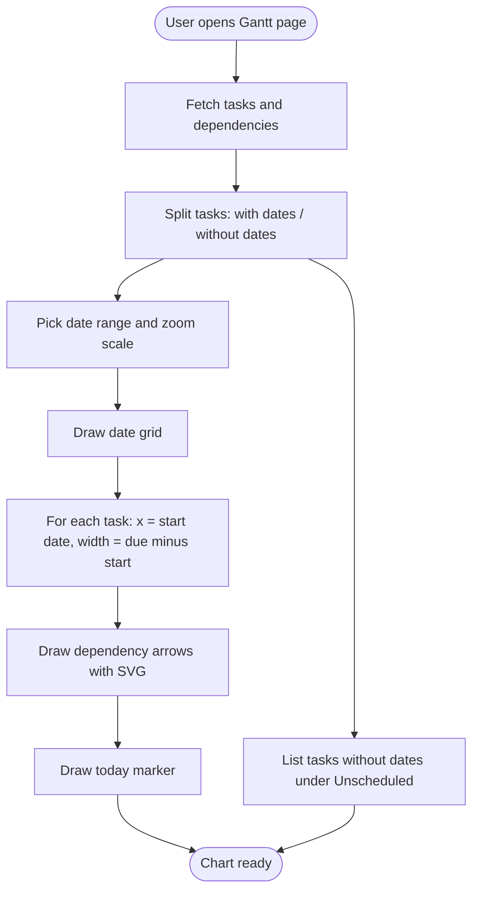
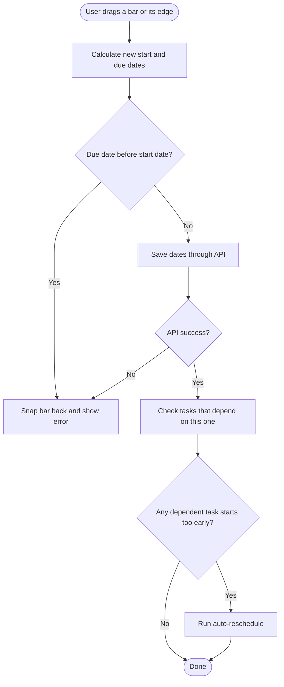
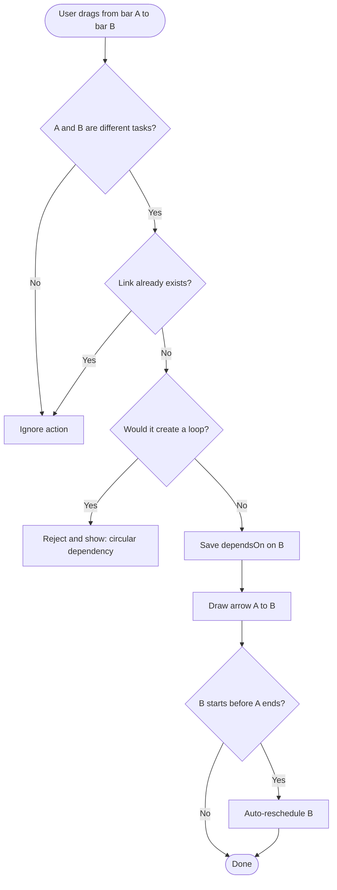
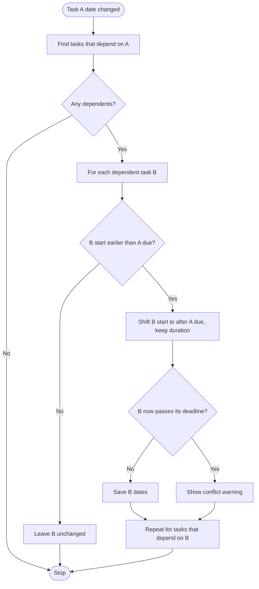

# Initiative 2: Gantt Chart

**Goal:** Show every task as a horizontal bar on a calendar, with arrows for dependencies. Users plan the whole schedule at a glance and change dates by dragging.

**Depends on:** Epic 1.0 (Core Task Data and CI) from the Kanban file. Tasks need start date, due date and `dependsOn` before any bar can be drawn.

**Build order:** Second. This is the hardest of the three because of dependencies.

> Flow charts below use Mermaid. They render on GitHub, GitLab, VS Code (with a Mermaid extension) and most Markdown viewers.

---

## 1. Common Definition of Done (applies to every Story)

- [ ] Feature runs locally without errors
- [ ] All Acceptance Criteria pass
- [ ] All Test Cases pass (positive and negative)
- [ ] Input validation and error handling are in place
- [ ] UI works on both mobile and desktop
- [ ] Code is committed and pushed to Git
- [ ] CI pipeline passes (green check on the commit or Pull Request)
- [ ] README or docs are updated

---

## 2. Use Cases

### UC-1: View the project schedule

| Item | Detail |
|---|---|
| Actor | Project manager, team member |
| Precondition | Tasks exist with start and due dates |
| Main flow | 1. User opens the Gantt page. 2. System loads tasks. 3. System draws the date grid at the chosen zoom. 4. System draws one bar per task from start date to due date. 5. System draws dependency arrows and the today marker. |
| Alternate flow | A task has no dates: it is listed in a separate "Unscheduled" section instead of the chart. |
| Postcondition | User sees the full schedule on one screen. |

### UC-2: Change zoom level

| Item | Detail |
|---|---|
| Actor | Project manager |
| Precondition | Gantt chart is open |
| Main flow | 1. User selects Day, Week or Month. 2. System recalculates the scale. 3. System redraws all bars and arrows. |
| Postcondition | Bar lengths still match their date ranges. |

### UC-3: Reschedule a task by dragging

| Item | Detail |
|---|---|
| Actor | Project manager |
| Precondition | Gantt chart is open |
| Main flow | 1. User drags a bar to move it, or drags an edge to resize it. 2. System calculates the new start and due dates. 3. System saves the dates through the API. |
| Alternate flow | New dates are invalid (due before start) or the API fails: bar snaps back and an error is shown. |
| Postcondition | Stored dates match the bar position. |

### UC-4: Create a dependency

| Item | Detail |
|---|---|
| Actor | Project manager |
| Precondition | At least two tasks exist |
| Main flow | 1. User drags from the end of bar A to bar B. 2. System checks for a circular dependency. 3. System saves `dependsOn` and draws an arrow from A to B. |
| Alternate flow | The link would create a loop (A to B to A): system rejects it and explains why. |
| Postcondition | B is shown as starting after A finishes. |

### UC-5: Auto-reschedule dependent tasks

| Item | Detail |
|---|---|
| Actor | System (triggered by a project manager) |
| Precondition | Task B depends on task A |
| Main flow | 1. User moves A later. 2. System finds every task that depends on A. 3. System shifts each dependent task so it starts after A ends. 4. System shows a conflict warning if a shifted task passes its deadline. |
| Postcondition | No dependent task starts before its predecessor ends. |

---

## 3. Flow Charts

### 3.1 Render the chart



### 3.2 Drag a bar to change dates



### 3.3 Create a dependency



### 3.4 Auto-reschedule dependent tasks



---

## 4. Epics, Stories, Tasks and Test Cases

### Epic 2.1: Chart Rendering

#### US-2.1: As a user, I can see each task as a horizontal bar on a calendar

**Tasks**
- T1 Task list on the left
- T2 Date grid on the right: day, week and month scale
- T3 Bar position and width from start date to due date

**Test Cases**
- [ ] TC1 Bar length matches the date range
- [ ] TC2 Tasks without dates are shown separately

#### US-2.2: As a user, I can switch zoom level (Day, Week, Month)

**Tasks**
- T1 Zoom toggle
- T2 Scale recalculation

**Test Cases**
- [ ] TC1 Bars stay correct after zoom change

#### US-2.3: As a user, I can see a marker for today's date

**Tasks**
- T1 Today marker

**Test Cases**
- [ ] TC1 Line sits on the correct date

---

### Epic 2.2: Interactions

#### US-2.4: As a user, I can drag a bar to change dates

**Tasks**
- T1 Drag the whole bar to move it
- T2 Save dates via API on drop
- T3 Resize from bar edges

**Test Cases**
- [ ] TC1 Dates update after drag
- [ ] TC2 Due date cannot go before start date

---

### Epic 2.3: Dependencies

#### US-2.5: As a user, I can see dependency arrows (A finishes, then B starts)

**Tasks**
- T1 Draw arrows with SVG
- T2 Create a dependency by dragging from one bar to another

**Test Cases**
- [ ] TC1 Arrow connects the correct bars
- [ ] TC2 Circular dependency is blocked

#### US-2.6: As a user, dependent tasks shift automatically when the first task is delayed

**Tasks**
- T1 Auto-reschedule logic
- T2 Conflict warning

**Test Cases**
- [ ] TC1 Changing A's date also moves B

---

## 5. Definition of Done (copy into each Story)

```
DoD
 ├─ Feature runs locally without errors
 ├─ All Test Cases pass
 ├─ Validation and error handling in place
 ├─ UI works on mobile and desktop
 ├─ Code committed and pushed to Git
 ├─ CI pipeline passes
 └─ README or docs updated
```
