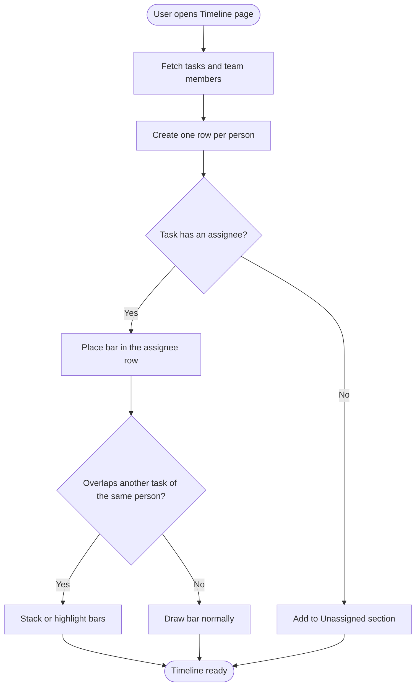
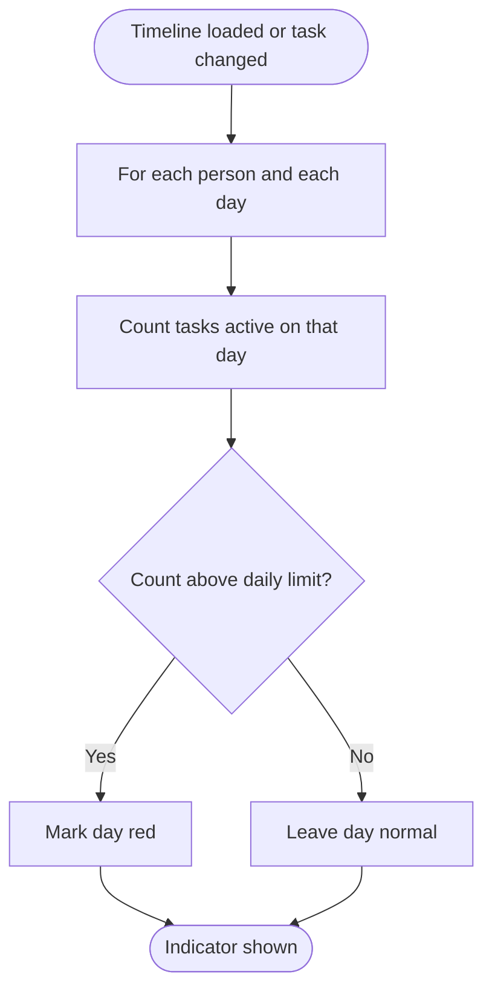
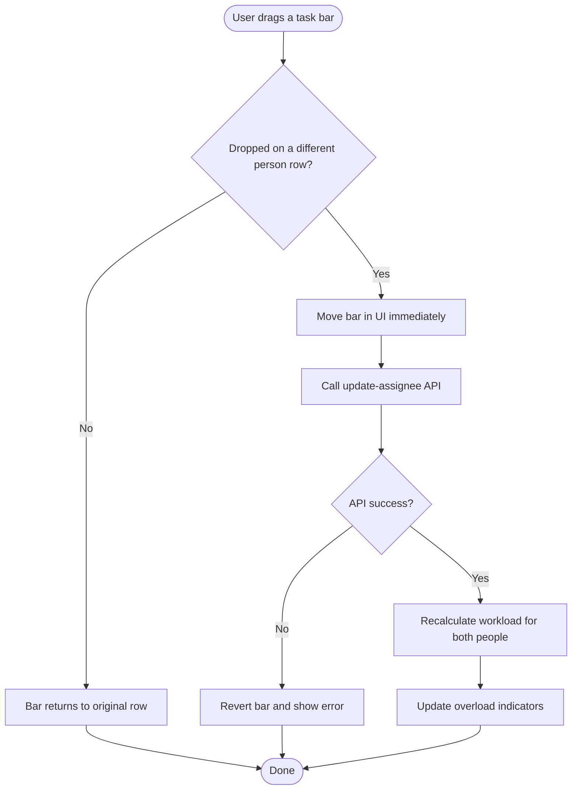
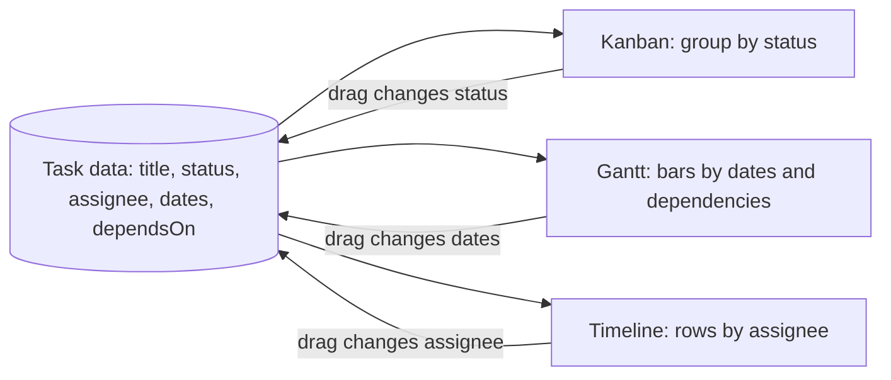

# Initiative 3: Timeline (Workload View)

**Goal:** Show one row per person with their tasks as bars over time, so a manager can see who is busy, who is overloaded and who has free capacity.

**Depends on:**
- Epic 1.0 (Core Task Data and CI) from the Kanban file, for task data with assignees and dates
- Gantt Epic 2.1 (date axis and bar components), which this view reuses

**Build order:** Last.

> Flow charts below use Mermaid. They render on GitHub, GitLab, VS Code (with a Mermaid extension) and most Markdown viewers.

---

## 1. Common Definition of Done (applies to every Story)

- [ ] Feature runs locally without errors
- [ ] All Acceptance Criteria pass
- [ ] All Test Cases pass (positive and negative)
- [ ] Input validation and error handling are in place
- [ ] UI works on both mobile and desktop
- [ ] Code is committed and pushed to Git
- [ ] CI pipeline passes (green check on the commit or Pull Request)
- [ ] README or docs are updated

---

## 2. Use Cases

### UC-1: View the team schedule by person

| Item | Detail |
|---|---|
| Actor | Team lead, project manager |
| Precondition | Tasks exist with assignees and dates |
| Main flow | 1. User opens the Timeline page. 2. System loads tasks and team members. 3. System creates one row per person. 4. System places each task as a bar in its assignee's row. |
| Alternate flow | A task has no assignee: it appears in an "Unassigned" section. |
| Postcondition | User sees who is working on what and when. |

### UC-2: Spot overlapping tasks

| Item | Detail |
|---|---|
| Actor | Team lead |
| Precondition | A person has two or more tasks on the same day |
| Main flow | 1. System detects the overlap. 2. System stacks or highlights the overlapping bars. 3. User sees both tasks clearly. |
| Postcondition | No task bar is hidden behind another. |

### UC-3: Find an overloaded person

| Item | Detail |
|---|---|
| Actor | Team lead |
| Precondition | Timeline is open |
| Main flow | 1. System counts tasks per person per day. 2. System compares the count with the daily limit. 3. System colors days above the limit red. |
| Postcondition | User can see at a glance who is overloaded. |

### UC-4: Reassign a task by dragging

| Item | Detail |
|---|---|
| Actor | Team lead |
| Precondition | Timeline is open and at least two people exist |
| Main flow | 1. User drags a task bar to another person's row. 2. System updates the assignee through the API. 3. System recalculates workload for both people. |
| Alternate flow | API fails: bar returns to the original row and an error is shown. |
| Postcondition | The task belongs to the new assignee in the database. |

---

## 3. Flow Charts

### 3.1 Build the people-wise layout



### 3.2 Detect overload



### 3.3 Reassign a task by drag



### 3.4 How the three views share data



---

## 4. Epics, Stories, Tasks and Test Cases

### Epic 3.1: People-wise Layout

#### US-3.1: As a user, I can see one row per person with their tasks as bars over time

**Tasks**
- T1 Assignee rows
- T2 Date axis (reuse the Gantt component)
- T3 Place tasks in rows by assignee

**Test Cases**
- [ ] TC1 Task appears in the correct person's row
- [ ] TC2 Unassigned tasks appear in a separate section

#### US-3.2: As a user, I can see overlapping tasks on the same day

**Tasks**
- T1 Overlap detection
- T2 Stack or highlight overlaps

**Test Cases**
- [ ] TC1 Two tasks on the same day are both visible

---

### Epic 3.2: Workload

#### US-3.3: As a user, I can see who is overloaded

**Tasks**
- T1 Per-day task count calculation
- T2 Overload indicator (color)

**Test Cases**
- [ ] TC1 Tasks above the limit show a red indicator

#### US-3.4: As a user, I can drag a task to another person to reassign it

**Tasks**
- T1 Drag between rows
- T2 Update assignee API

**Test Cases**
- [ ] TC1 Assignee changes after drop

---

## 5. Definition of Done (copy into each Story)

```
DoD
 ├─ Feature runs locally without errors
 ├─ All Test Cases pass
 ├─ Validation and error handling in place
 ├─ UI works on mobile and desktop
 ├─ Code committed and pushed to Git
 ├─ CI pipeline passes
 └─ README or docs updated
```
